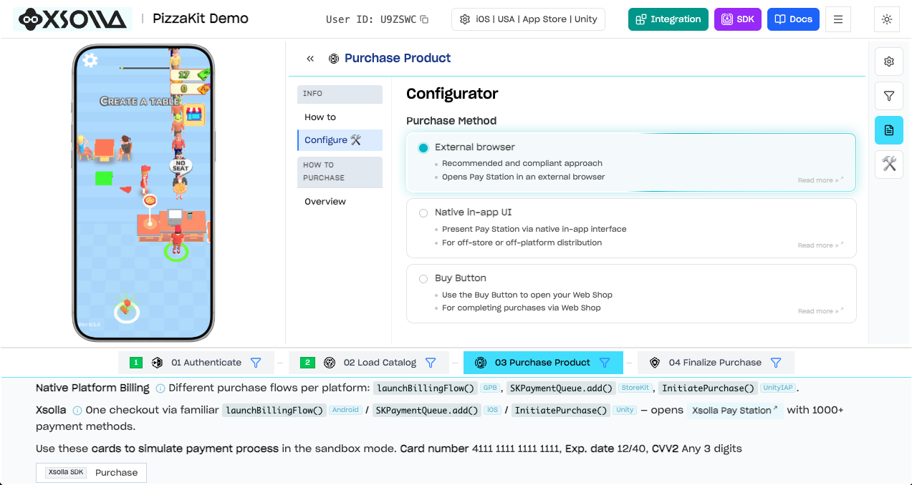

# Xsolla Mobile SDK for Unity

[](https://unity.com)
[](https://docs.unity3d.com/Packages/com.unity.purchasing@5.4/manual/index.html)
[](https://docs.microsoft.com/en-us/dotnet/csharp/)
[](https://docs.unity3d.com/Manual/upm-ui.html)

Pre-built Unity SDK for integrating in-game payments into your app via Xsolla Pay Station.

> **Winzardy fork.** Upstream [xsolla/xsolla-sdk-unity](https://github.com/xsolla/xsolla-sdk-unity) targets Unity IAP 4.x and does not support 5.x.
> This fork keeps the SDK itself as in upstream `3.1.9` and ports the Unity Purchasing bridge (`Xsolla.SDK.UnityPurchasing`) to the Unity IAP 5 store SPI.
> Fork versions carry the `-iap5.N` suffix on top of the upstream version they are based on, see [CHANGELOG.md](CHANGELOG.md).
> If you need Unity IAP 4.x, use upstream.

## SDK Explorer

See exactly how payments work before writing a single line of code. The SDK Explorer lets you walk through authentication, catalog loading, purchasing, and finalization — all in an interactive environment.

[](https://developers.xsolla.com/sdk/demo/)

[**Integrate Now →**](https://developers.xsolla.com/sdk/demo/)

## Essential Links

- [SDK Explorer](https://developers.xsolla.com/sdk/demo/) — interactive demo
- [SDK Documentation](https://developers.xsolla.com/sdk/) — full integration guide
- [Demo App](https://github.com/xsolla/xsolla-sdk-demo) — sample project

## Overview

Xsolla Mobile SDK provides a Unity IAP-compatible store for in-game purchases via Xsolla Pay Station. It plugs into Unity IAP 5 as a custom store, so the purchase flow goes through the standard `StoreController` and its events, the same way the built-in stores do.

**Key features:**

- 1000+ payment methods across 200+ geographies
- 130+ currencies including local and alternative payment methods
- Built-in anti-fraud protection
- 25+ languages supported out of the box
- Player authentication (Xsolla Login widget, social login, custom tokens)
- Product catalog and virtual items
- Buy Button and Web Shop integration

## Requirements

- Unity 2022.3 LTS or later
- Unity IAP (`com.unity.purchasing`) 5.4.3 or later

## Installation

Add the package via Unity Package Manager using the Git URL of the fork, pinned to a commit or a tag:

1. In Unity, go to **Window > Package Manager**
2. Click **+** > **Add package from git URL...**
3. Enter:
   ```
   https://github.com/Winzardy/xsolla-sdk-unity.git#<commit-or-tag>
   ```
4. Click **Add**

Scripting defines:

- `XSOLLA_SDK_UNITY_PURCHASING_DISABLE` — excludes the Unity Purchasing bridge (`Xsolla.SDK.UnityPurchasing`) from the build, the rest of the SDK stays available
- `XSOLLA_SDK_DISABLE` — excludes the whole SDK

## Quick Start

### 1. Register the store

Configure the SDK with your project credentials and register the Xsolla store in Unity IAP:

```csharp
using UnityEngine.Purchasing;
using Xsolla.SDK.Common;
using Xsolla.SDK.UnityPurchasing;

var settings = XsollaClientSettings.Builder.Create()
    .SetProjectId(77640)
    .SetLoginId("026201e3-7e40-11ea-a85b-42010aa80004")
    .Build();

var configuration = XsollaClientConfiguration.Builder.Create()
    .SetSettings(settings)
    .SetSandbox(true)
    .Build();

var module = XsollaPurchasingModule.Builder.Create()
    .SetConfiguration(configuration)
    .Build();

// Once per process: Unity IAP keeps the first store registered under a name
UnityIAPServices.AddNewCustomStore(module);
```

### 2. Connect and load the catalog

Take the store controller by the Xsolla store name, subscribe to its events and connect:

```csharp
using System.Collections.Generic;
using System.Threading.Tasks;
using UnityEngine.Purchasing;
using UnityEngine.Purchasing.Extension;
using Xsolla.SDK.UnityPurchasing;

private StoreController _controller;
private IXsollaPurchasingStoreExtension _xsolla;

private async Task InitializeAsync(XsollaPurchasingModule module)
{
    _controller = UnityIAPServices.StoreController(XsollaPurchasingModule.StoreName);
    _xsolla = module.Extension;

    // Subscribe before Connect: purchases can be reported right after the connection
    _controller.OnStoreDisconnected += OnStoreDisconnected;
    _controller.OnProductsFetched += OnProductsFetched;
    _controller.OnProductsFetchFailed += OnProductsFetchFailed;
    _controller.OnPurchasesFetched += OnPurchasesFetched;
    _controller.OnPurchasePending += OnPurchasePending;
    _controller.OnPurchaseFailed += OnPurchaseFailed;

    await _controller.Connect();

    if (_controller.GetConnectionState() != ConnectionState.Connected)
        return; // the failure was reported through OnStoreDisconnected

    var products = new List<ProductDefinition>
    {
        new ProductDefinition("com.xsolla.crystals.10", ProductType.Consumable)
        // ...more products
    };

    _controller.FetchProducts(products);
}

private void OnProductsFetched(List<Product> products)
{
    // Restores purchases and delivers unfinished ones, see step 4. Needs the catalog, so it goes after
    _controller.FetchPurchases();
}

private void OnStoreDisconnected(StoreConnectionFailureDescription description) { /* Handle error */ }
private void OnProductsFetchFailed(ProductFetchFailed failed) { /* Handle error */ }
private void OnPurchaseFailed(FailedOrder order) { /* Handle error */ }
```

### 3. Purchase

```csharp
Product product = _controller.GetProductById("com.xsolla.crystals.10");
_controller.PurchaseProduct(product);
```

### 4. Validate and confirm

A successful payment arrives as a pending order. Validate the receipt with the Xsolla backend, award the product, then confirm the order — consumables are consumed at Xsolla by the confirmation:

```csharp
private void OnPurchasePending(PendingOrder order)
{
    _xsolla.GetValidator().Validate(order.Info.Receipt, (success, error) =>
    {
        if (!success)
        {
            // Leave the order pending, it comes back with the next FetchPurchases
            return;
        }

        // Award the product to the user
        _controller.ConfirmPurchase(order);
    });
}

private void OnPurchasesFetched(Orders orders)
{
    // Unity IAP reroutes fetched pending orders to OnPurchasePending only for its built-in stores,
    // for a custom store they arrive here
    foreach (var order in orders.PendingOrders)
        OnPurchasePending(order);
}
```

## Xsolla specifics

- **`XsollaPurchasingModule.Extension`** replaces `IExtensionProvider.GetExtension<IXsollaPurchasingStoreExtension>()` of Unity IAP 4: receipt validator, access token, restore, Xsolla product data and icon URLs.
- **`SetPurchaseArgsProvider`** prepares `XsollaStoreClientPurchaseArgs` for every purchase started through `StoreController`, a payment token for instance. Passing `null` to `onReady` cancels the purchase, it is reported as `PurchaseFailureReason.UserCancelled`. Prefer it over `InitiatePurchase`, which bypasses the `StoreController` bookkeeping.
- **Failures are not retried by Unity IAP.** Connection and catalog failures are reported as non-retryable, the default Unity IAP policy would otherwise retry them forever. Retry from the application.
- **Catalog first.** `FetchPurchases` and `CheckEntitlement` build orders from the products Unity IAP has cached, call them after `OnProductsFetched`.
- **Receipt.** `Order.Info.Receipt` is the unified receipt `{"Payload":"<Xsolla receipt>","Store":"XsollaStore","TransactionID":"..."}`. `GetValidator().Validate` accepts the unified receipt as well as the bare payload.

## Migrating from upstream (Unity IAP 4)

| Upstream, Unity IAP 4 | This fork, Unity IAP 5 |
|---|---|
| `ConfigurationBuilder.Instance(module)` + `UnityPurchasing.Initialize(listener, builder)` | `UnityIAPServices.AddNewCustomStore(module)` + `UnityIAPServices.StoreController(XsollaPurchasingModule.StoreName)` |
| `IStoreListener.OnInitialized(controller, extensions)` | `StoreController.OnStoreConnected`, `OnProductsFetched` |
| `extensions.GetExtension<IXsollaPurchasingStoreExtension>()` | `module.Extension` |
| `IStoreController.InitiatePurchase(product)` | `StoreController.PurchaseProduct(product)` |
| `ProcessPurchase(PurchaseEventArgs)` returning `PurchaseProcessingResult.Pending` | `OnPurchasePending(PendingOrder)` |
| `args.purchasedProduct.receipt` | `order.Info.Receipt` |
| `ConfirmPendingPurchase(product)` | `ConfirmPurchase(order)` |
| `OnPurchaseFailed(Product, PurchaseFailureReason)` | `OnPurchaseFailed(FailedOrder)` |
| Pending purchases from `RestorePurchases` come to `ProcessPurchase` | `OnPurchasesFetched(Orders).PendingOrders`, see step 4 |
| `IXsollaPurchasingStoreConfiguration` | Removed, `IStoreConfiguration` is legacy in Unity IAP 5 |

> For the SDK itself — authentication, catalog, Pay Station — see the [SDK Documentation](https://developers.xsolla.com/sdk/).
